<!-- Modified for Safety Gymnasium 2. -->
<h1 align="center">Safety Gymnasium 2</h1>

<p align="center">
  <a href="https://pypi.org/project/safety-gymnasium2/"></a>
  
  <a href="https://github.com/LIRA-illinois/safety-gymnasium2/blob/main/LICENSE"></a>
  <a href="https://github.com/LIRA-illinois/safety-gymnasium2/stargazers"></a>
</p>

<p align="center">
  <a href="#why-safety-gymnasium2">Why Safety-Gymnasium2?</a> |
  <a href="https://tran.aerospace.illinois.edu/safety-gymnasium2/">Documentation</a> |
  <a href="#environments">Environments</a> |
  <a href="#installation">Install guide</a> |
  <a href="#customize-your-environments">Customization</a>
</p>

Safety Gymnasium 2 is the LIRA research fork of Safety Gymnasium for safe reinforcement learning. It provides single-agent and multi-agent MuJoCo environments where agents receive a reward for completing a task and a separate cost for violating safety constraints.

## Citing Safety-Gymnasium2

Cite this repository when using the fork in research and record the package version or Git commit used in your experiments.

```bibtex
@misc{safetygymnasium2,
  author = {{Safety Gymnasium 2 Contributors}},
  title = {Safety Gymnasium 2},
  howpublished = {GitHub repository},
  url = {https://github.com/LIRA-illinois/safety-gymnasium2}
}
```

See [CITATION.cff](https://github.com/LIRA-illinois/safety-gymnasium2/blob/main/CITATION.cff) for software citation metadata. The fork builds on [Safety-Gymnasium](https://github.com/PKU-Alignment/safety-gymnasium) and its [benchmark paper](https://arxiv.org/abs/2310.12567).

---

## Why Safety-Gymnasium2?

Safety-Gymnasium is no longer actively maintained and pins Gymnasium 0.28.1, Gymnasium-Robotics 1.2.2, and MuJoCo 2.3.3. Safety Gymnasium 2 updates these dependencies to Gymnasium 1.2+, Gymnasium-Robotics 1.4.2+, and MuJoCo 4.0.1+ on Python 3.11+. The package declares minimum compatible versions and uses a `uv` lockfile for reproducible development. See the [upstream dependency declarations](https://github.com/PKU-Alignment/safety-gymnasium/blob/ae966e511b9927f06b39c727ca5c650136a4e696/pyproject.toml#L25-L34) and the [fork overview](https://tran.aerospace.illinois.edu/safety-gymnasium2/introduction/about_safety_gymnasium.html).

| SafeRL environments | Engine | Vectorized environments | Gymnasium 1.2+ API | Vision input |
| --- | --- | :---: | :---: | :---: |
| [Safety-Gym](https://github.com/openai/safety-gym)<br> | MuJoCo via `mujoco-py` | ❌ | ❌ | Limited |
| [safe-control-gym](https://github.com/learnsyslab/safe-control-gym)<br> | PyBullet | ✅ [Vector wrappers](https://github.com/learnsyslab/safe-control-gym/tree/main/safe_control_gym/envs/env_wrappers/vectorized_env) | ❌ | ❌ |
| Velocity-Constraints | — | — | — | — |
| [mujoco-circle](https://github.com/ymzhang01/mujoco-circle)<br> | MuJoCo via `mujoco-py` | ❌ | ❌ | ❌ |
| [Safety-Gymnasium](https://github.com/PKU-Alignment/safety-gymnasium)<br> | MuJoCo 2.3.3 (pinned) | ✅ | ❌ | ✅ Dedicated vision environments |
| **[Safety Gymnasium 2](https://github.com/LIRA-illinois/safety-gymnasium2)**<br> | **MuJoCo 4.0.1+** | ✅ | ✅ | ✅ Configurable RGB observations |

Velocity-Constraints refers to a benchmark setup that adds a speed limit to a locomotion task, so its features depend on the base environment.

The fork retains the native six-value step API and offers namespaced single-agent environments for Gymnasium wrappers and algorithms. Its vector API carries terminal observations and costs through same-step resets.

---

## Environments

Navigation environments combine robots, tasks, and difficulty levels. For example, `SafetyPointGoal1-v0` uses the Point robot on Goal level 1. Safety-Gymnasium ported tasks from Safety-Gym to the native MuJoCo bindings. The [Safety-Gym bug report](https://github.com/LIRA-illinois/safety-gymnasium2/blob/main/safety_gym_bug_report.md) documents the upstream fixes.

<table>
  <thead>
    <tr><th>Category</th><th>Task</th><th>Agents or configurations</th><th>Example</th></tr>
  </thead>
  <tbody>
    <tr>
      <td rowspan="7"><a href="https://tran.aerospace.illinois.edu/safety-gymnasium2/environments/safe_navigation.html">Safe Navigation</a></td>
      <td>Goal 0–2</td>
      <td rowspan="7">Point, Car, Racecar, Doggo, Ant</td>
      <td><code>SafetyPointGoal1-v0</code></td>
    </tr>
    <tr><td>Button 0–2</td><td><code>SafetyCarButton1-v0</code></td></tr>
    <tr><td>Push 0–2</td><td><code>SafetyRacecarPush1-v0</code></td></tr>
    <tr><td>Circle 0–2</td><td><code>SafetyDoggoCircle1-v0</code></td></tr>
    <tr><td>Run 0</td><td><code>SafetyAntRun0-v0</code></td></tr>
    <tr><td>FadingEasy 0–2</td><td><code>SafetyPointFadingEasy1-v0</code></td></tr>
    <tr><td>FadingHard 0–2</td><td><code>SafetyPointFadingHard1-v0</code></td></tr>
    <tr>
      <td><a href="https://tran.aerospace.illinois.edu/safety-gymnasium2/environments/safe_velocity.html">Safe Velocity</a></td>
      <td>Velocity v0, v1, v2</td>
      <td>HalfCheetah, Hopper, Swimmer, Walker2d, Ant, Humanoid</td>
      <td><code>SafetyHalfCheetahVelocity-v2</code></td>
    </tr>
    <tr>
      <td rowspan="2">Safe Multi-Agent</td>
      <td>MultiGoal 0–2</td>
      <td>Point, Ant</td>
      <td><code>SafetyAntMultiGoal0-v0</code></td>
    </tr>
    <tr>
      <td><a href="https://tran.aerospace.illinois.edu/safety-gymnasium2/environments/safe_multi_agent/velocity.html">Multi-Agent Velocity</a></td>
      <td>HalfCheetah (6x1, 2x3), Hopper (3x1), Swimmer (2x1), Walker2d (2x3), Ant (2x4, 4x2), Humanoid (9|8)</td>
      <td><code>sg2.make_ma('Ant', '2x4')</code></td>
    </tr>
  </tbody>
</table>

### Navigation agents

<table>
  <tbody>
    <tr>
      <td align="center"><a href="https://tran.aerospace.illinois.edu/safety-gymnasium2/components_of_environments/agents/point.html">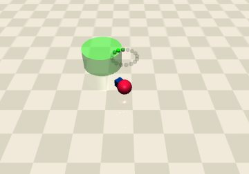<br>Point</a></td>
      <td align="center"><a href="https://tran.aerospace.illinois.edu/safety-gymnasium2/components_of_environments/agents/car.html">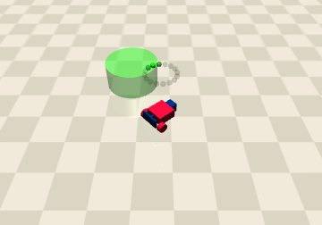<br>Car</a></td>
      <td align="center"><a href="https://tran.aerospace.illinois.edu/safety-gymnasium2/components_of_environments/agents/racecar.html">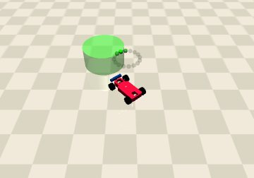<br>Racecar</a></td>
      <td align="center"><a href="https://tran.aerospace.illinois.edu/safety-gymnasium2/components_of_environments/agents/doggo.html">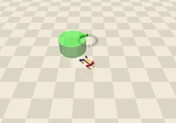<br>Doggo</a></td>
      <td align="center"><a href="https://tran.aerospace.illinois.edu/safety-gymnasium2/components_of_environments/agents/ant.html">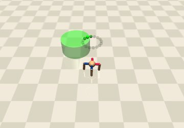<br>Ant</a></td>
    </tr>
  </tbody>
</table>

### Navigation tasks

Each row shows the Point robot in one task across all three difficulty levels. The screenshots were rendered from the environments in release 2.0.0 with seed 17.

<table>
  <thead>
    <tr><th>Task</th><th>Level 0</th><th>Level 1</th><th>Level 2</th></tr>
  </thead>
  <tbody>
    <tr>
      <th><a href="https://tran.aerospace.illinois.edu/safety-gymnasium2/environments/safe_navigation/goal.html">Goal</a></th>
      <td>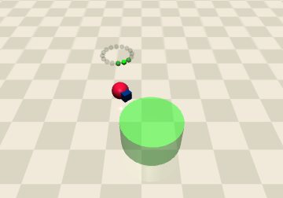</td>
      <td>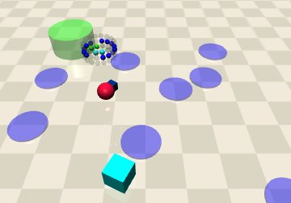</td>
      <td>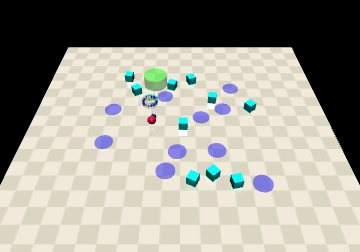</td>
    </tr>
    <tr>
      <th><a href="https://tran.aerospace.illinois.edu/safety-gymnasium2/environments/safe_navigation/button.html">Button</a></th>
      <td>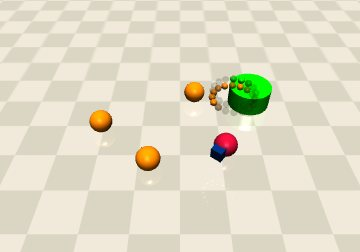</td>
      <td>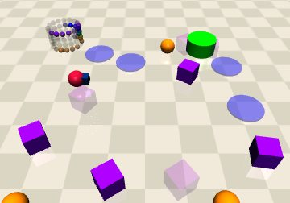</td>
      <td>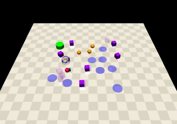</td>
    </tr>
    <tr>
      <th><a href="https://tran.aerospace.illinois.edu/safety-gymnasium2/environments/safe_navigation/push.html">Push</a></th>
      <td>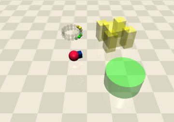</td>
      <td>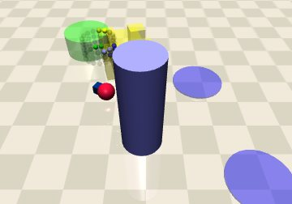</td>
      <td>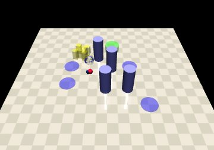</td>
    </tr>
    <tr>
      <th><a href="https://tran.aerospace.illinois.edu/safety-gymnasium2/environments/safe_navigation/circle.html">Circle</a></th>
      <td>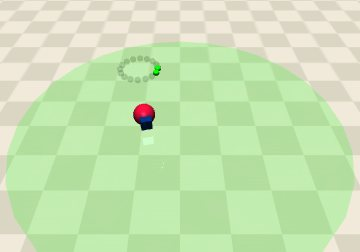</td>
      <td>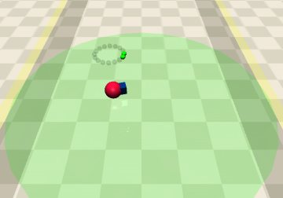</td>
      <td>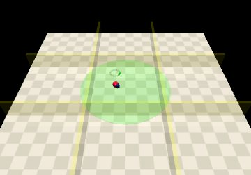</td>
    </tr>
  </tbody>
</table>

---

## Environment Usage

### Native safety API

```python
import safety_gymnasium2 as sg2

with sg2.make('SafetyPointGoal1-v0') as env:
    observation, info = env.reset(seed=17)
    action = env.action_space.sample()
    observation, reward, cost, terminated, truncated, info = env.step(action)
```

The six values from `step()` are the next observation, reward, safety cost, termination flag, truncation flag, and extra information. Use `terminated or truncated` to decide when to reset. Set `render_mode='human'` to view the simulation interactively or `render_mode='rgb_array'` to capture a frame with `env.render()`.

### Standard Gymnasium API

Import Safety Gymnasium 2 to register the `SafetyGymnasium2/` aliases. These single-agent environments return the Gymnasium five-value tuple and store the cost in `info['cost']`.

```python
import gymnasium as gym
import safety_gymnasium2

with gym.make('SafetyGymnasium2/SafetyPointGoal1Gymnasium-v0') as env:
    observation, info = env.reset(seed=17)
    observation, reward, terminated, truncated, info = env.step(env.action_space.sample())
    cost = info['cost']
```

You can also apply Gymnasium wrappers to a native environment through `with_gymnasium_wrappers`. The wrapped environment returns all six values.

```python
from functools import partial

import gymnasium as gym
import safety_gymnasium2 as sg2
from safety_gymnasium2.wrappers import with_gymnasium_wrappers

scale_reward = partial(gym.wrappers.TransformReward, func=lambda reward: reward * 0.1)
with with_gymnasium_wrappers(sg2.make('SafetyPointGoal1-v0'), scale_reward) as env:
    observation, info = env.reset(seed=17)
    observation, reward, cost, terminated, truncated, info = env.step(env.action_space.sample())
```

### Vectorized environments

```python
from contextlib import closing

import safety_gymnasium2 as sg2

vector_env = sg2.vector.make(
    'SafetyPointGoal1-v0', num_envs=2, asynchronous=False, max_episode_steps=2
)
with closing(vector_env) as env:
    observations, info = env.reset(seed=17)
    for _ in range(2):
        actions = env.action_space.sample()
        observations, rewards, costs, terminations, truncations, info = env.step(actions)
    final_observations = info['final_observation'][info['_final_observation']]
```

With same-step autoreset, lanes that finish return their reset observation in `observations`. For those lanes, use the masked `final_observation` entries to recover the terminal observations. The reward and cost arrays describe the transitions that just finished.

### Multi-agent environments

MultiGoal navigation uses a registered environment ID. Sample one action per agent from its action space.

```python
import safety_gymnasium2 as sg2

with sg2.make('SafetyAntMultiGoal0-v0') as env:
    observations, info = env.reset(seed=17)
    action_space = env.get_wrapper_attr('action_space')
    agents = env.get_wrapper_attr('agents')
    actions = {agent: action_space(agent).sample() for agent in agents}
    observations, rewards, costs, terminations, truncations, infos = env.step(actions)
```

For multi-agent velocity tasks, pass the robot and agent partition to `make_ma`. In `2x4` Ant, two agents each control four actuators.

```python
from contextlib import closing

import safety_gymnasium2 as sg2

with closing(sg2.make_ma('Ant', '2x4')) as env:
    observations, infos = env.reset(seed=17)
    actions = {agent: env.action_space(agent).sample() for agent in env.agents}
    observations, rewards, costs, terminations, truncations, infos = env.step(actions)
```

See [Basic Usage](https://tran.aerospace.illinois.edu/safety-gymnasium2/introduction/basic_usage.html) for more examples.

### Benchmark versions

`Safety{Robot}Velocity-v0` and `-v1` use Gymnasium's v4 locomotion implementations. `-v2` uses upstream v5 observations, rewards, and termination with Safety Velocity v1 costs and episode limits. For example, Ant observations change from 27 to 105 values by default, and Humanoid observations change from 376 to 348. The Robotics upgrade also changes some multi-agent observation shapes. Ant with `2x4` changes from 21 to 63 values per agent. See the [benchmark notes](https://github.com/LIRA-illinois/safety-gymnasium2/tree/main/benchmarks#reproducing-new-runs) for what to record with each experiment.

---

## Installation

Use Python 3.11 or newer in an active virtual environment. The package is available on [PyPI](https://pypi.org/project/safety-gymnasium2/).

```sh
python -m pip install safety-gymnasium2
```

For development, clone the repository and sync its locked dependencies.

```sh
git clone https://github.com/LIRA-illinois/safety-gymnasium2.git
cd safety-gymnasium2
uv sync --locked
```

To install directly from the checkout with pip, run `python -m pip install .`. On headless Ubuntu, install `libosmesa6` and set `MUJOCO_GL=osmesa` and `PYOPENGL_PLATFORM=osmesa` before starting Python.

## Keyboard Debugging

Use the Debug variants to inspect task layouts and try controls for Point, Car, and Racecar. Run this example from the repository checkout and use **I**, **K**, **J**, and **L** to drive the agent.

```sh
uv run --locked python examples/env.py --env SafetyCarGoal2Debug-v0
```

## Customize Your Environments

The navigation `Base` IDs let you configure placements, objects, and observations while keeping the task's reward and cost logic. For example, configure a Point Goal task with one goal, one hazard, and 24 lidar bins.

```python
import safety_gymnasium2 as sg2

config = {
    'Goal': {'locations': [(1.0, 1.0)]},
    'Hazards': {'num': 1, 'locations': [(-1.0, -1.0)]},
    'lidar_conf.num_bins': 24,
}

with sg2.make('SafetyPointGoalBase-v0', config=config) as env:
    observation, info = env.reset(seed=17)
    observation, reward, cost, terminated, truncated, info = env.step(env.action_space.sample())
```

See the [configuration example](https://github.com/LIRA-illinois/safety-gymnasium2/blob/main/examples/env_from_config.py) for more object options and the [task example](https://tran.aerospace.illinois.edu/safety-gymnasium2/components_of_environments/tasks/task_example.html) for defining your own task.

## License

The project uses [Apache-2.0](https://github.com/LIRA-illinois/safety-gymnasium2/blob/main/LICENSE). Bundled components have their own notices, including the [MIT license](https://github.com/LIRA-illinois/safety-gymnasium2/blob/main/LICENSE-MIT). See [NOTICE](https://github.com/LIRA-illinois/safety-gymnasium2/blob/main/NOTICE) for provenance.
