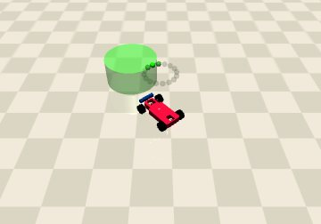

.. Modified for Safety Gymnasium 2.

Racecar
=======

A robot closer to realistic car dynamics, moving in three dimensions, has one velocity servo and one position servo, one to adjust the rear wheel speed to the target speed and the other to adjust the front wheel steering angle to the target angle. Racecar references the widely known MIT Racecar project's dynamics model. For it to accomplish the specified goal, it must coordinate the relationship between the steering angle of the tires and the speed, just like a human driving a car.

   Racecar in the navigation Goal task.

+---------------------------------+-------------------------------------------------------------------+
| **Specific Action Space**       | Box([-20.          -0.785], [20.          0.785], (2,), float64)  |
+---------------------------------+-------------------------------------------------------------------+
| **Specific Observation Shape**  | (12,)                                                             |
+---------------------------------+-------------------------------------------------------------------+
| **Specific Observation High**   | inf                                                               |
+---------------------------------+-------------------------------------------------------------------+
| **Specific Observation Low**    | -inf                                                              |
+---------------------------------+-------------------------------------------------------------------+

Specific Action Space
---------------------

+------+-------------------------------+--------------+--------------+-----------------------------------+-------------+-----------------+
| Num  | Action                        | Control Min  | Control Max  | Name (in corresponding XML file)  | Joint/Site  | Unit            |
+======+===============================+==============+==============+===================================+=============+=================+
| 0    | Velocity of the rear wheels.  | -20          | 20           | diff_ring                         | hinge       | velocity (m/s)  |
+------+-------------------------------+--------------+--------------+-----------------------------------+-------------+-----------------+
| 1    | Angle of the front wheel.     | 0            | 1            | steering_hinge                    | hinge       | angle (rad)     |
+------+-------------------------------+--------------+--------------+-----------------------------------+-------------+-----------------+

Specific Observation Space
--------------------------

+-------+----------------+------+------+-----------------------------------+-------------+----------------------------+
| Size  | Observation    | Min  | Max  | Name (in corresponding XML file)  | Joint/Site  | Unit                       |
+=======+================+======+======+===================================+=============+============================+
| 3     | accelerometer  | -inf | inf  | accelerometer                     | site        | acceleration (m/s^2)       |
+-------+----------------+------+------+-----------------------------------+-------------+----------------------------+
| 3     | velocimeter    | -inf | inf  | velocimeter                       | site        | velocity (m/s)             |
+-------+----------------+------+------+-----------------------------------+-------------+----------------------------+
| 3     | gyro           | -inf | inf  | gyro                              | site        | anglular velocity (rad/s)  |
+-------+----------------+------+------+-----------------------------------+-------------+----------------------------+
| 3     | magnetometer   | -inf | inf  | magnetometer                      | site        | magnetic flux (Wb)         |
+-------+----------------+------+------+-----------------------------------+-------------+----------------------------+

Specific Starting Randomness
----------------------------

Nothing.

Specific Episode End
--------------------

Nothing.
