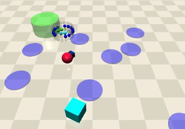

.. Modified for Safety Gymnasium 2.

Tasks
=====

A task defines the objective, reward, safety constraints, and environment
configuration. See the :doc:`../environments/safe_navigation`,
:doc:`../environments/safe_velocity`, and :doc:`../environments/safe_multi_agent`
references for the benchmarks in this release.

   Goal level 1 adds hazards and a vase to the Goal task.

.. toctree::
   :maxdepth: 1

   tasks/task_example
