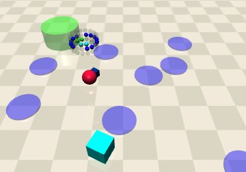

.. Modified for Safety Gymnasium 2.

Overview
========

Why Safety Gymnasium 2?
-----------------------

Safety Gymnasium 2 is the independent LIRA fork of the original
`Safety Gymnasium benchmark <https://arxiv.org/abs/2310.12567>`__. The
original provided modular MuJoCo tasks, vectorized environments, and a
native step API with a separate safety cost. At the fork point its core
dependencies pinned Gymnasium 0.28.1, Gymnasium-Robotics 1.2.2, and
MuJoCo 2.3.3.

The fork supports Python 3.11 or newer, Gymnasium 1.2 or newer,
Gymnasium-Robotics 1.4.2 or newer, and MuJoCo 4.0.1 or newer. Dependency
ranges allow updates, while the ``uv`` lockfile records a reproducible
development environment. Continuous integration checks the supported
Python versions and dependency stacks.

The native API retains the six-value safety step. Namespaced
``SafetyGymnasium2/`` aliases expose the cost in Gymnasium's five-value
step. Vector environments preserve terminal observations and costs when
lanes reset, and reward and cost normalization follow episode boundaries.
See :doc:`basic_usage` for the APIs.

The released catalog covers :doc:`../environments/safe_navigation`,
:doc:`../environments/safe_velocity`, and
:doc:`../environments/safe_multi_agent`. Velocity v2 uses Gymnasium's
v5 observations, rewards, and termination with the v1 safety thresholds
and horizons. Record the environment ID, commit, configuration, seeds,
and simulator versions when comparing results. The
`benchmark notes <https://github.com/LIRA-illinois/safety-gymnasium2/tree/main/benchmarks>`__
distinguish historical upstream results from runs using this fork.

   Point in Goal level 1. The agent earns reward for reaching the goal and incurs a cost for entering hazards.

About Safe RL
-------------

In recent years, RL (reinforcement learning) algorithms, especially DeepRL algorithms, have achieved good performance in numerous tasks. For example: gaining high scores in Atari games using only visual input, fulfilling complex control tasks in high dimensions, and beating human grandmasters in Go competitions. However, in the process of policy optimization in RL, there are problems that need Safe RL to solve.

.. grid:: 12 4 4 4

    .. grid-item-card::
        :class-item: sd-font-weight-bold
        :class-header: sd-bg-danger sd-text-white sd-font-weight-bold
        :class-card: sd-outline-success sd-border-{3} sd-shadow-sm sd-rounded-3
        :columns: 12 6 6 6

        .. card-header::

            Problems

        Agents may learn

        - Reward Hacking
        - Risk Behavior
        - Unrealistic Strategy

        to improve their cumulative rewards, This may lead to **one-sided pursuit of reward** and **contradict the original purpose** of our reward design.

    .. grid-item-card::
        :class-item: sd-font-weight-bold
        :class-header: sd-bg-info sd-text-white sd-font-weight-bold
        :class-card: sd-outline-success sd-border-{3} sd-shadow-sm sd-rounded-3
        :columns: 12 6 6 6

        .. card-header::

            Solutions

        Therefore, the **Safe RL algorithm aims to** train the Agent to act while

        - Maximizing the reward
        - Satisfying the given constraints.

        so as to avoid learning behavioral policies that are out of touch with reality and one-sidedly pursue reward.

Reinforcement learning can be considered as an agent continuously optimizing its own policy by learning from a given reward signal, and is very effective in solving problems that cannot be strictly modeled mathematically. On this foundation, Safe RL can also be broadly understood as a **constraint solving problem**: the agent needs to learn the reward signal along with the constraint signal to maximize the reward while satisfying the constraint.
